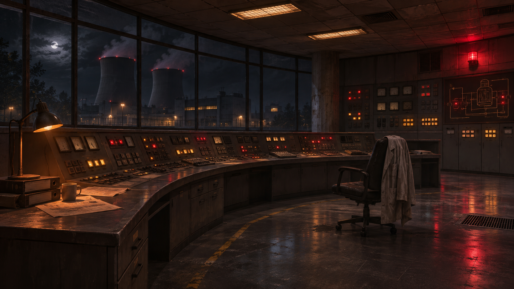

# CONTAINMENT

**03:42. O reator desliga automaticamente. A cadeira de Lia está vazia. No terminal, uma mensagem dela aguarda desde as 03:31.**

Em CONTAINMENT, você assume o papel de Alex, operador de apoio na fictícia Usina Aurora. Depois de um acidente industrial, você precisa localizar uma colega, investigar o que aconteceu no turno anterior e explicar por que sua assinatura aparece em um checklist incompleto.

🎮 **[Jogar CONTAINMENT no navegador](https://thamirixs.github.io/CONTAINMENT/)**

## Como jogar

Clique em **Iniciar turno**, leia a cena e escolha uma ação. Você pode levar o tempo que quiser para ler. O relógio do jogo só avança quando você age, e cada opção mostra quantos minutos custa. No abrigo, visitar o arquivo técnico pode render uma prova para a investigação, mas também consome tempo que poderia ser usado na busca por Lia.

Os quatro capítulos têm **26 cenas possíveis e seis finais**. As decisões anteriores mudam os diálogos, as pistas disponíveis e o tempo de resposta das equipes. Ao concluir a partida, você pode baixar um relatório com seus horários, escolhas e consequências.

A partida é salva automaticamente após cada decisão. Para continuar depois, abra o jogo no mesmo navegador e clique em **Carregar partida**.

## Sobre os indicadores

- **Integridade física** representa ferimentos industriais, como cortes e quedas.
- **Dose acumulada** registra a exposição à radiação ao longo da partida.
- **Contaminação externa** representa material radioativo presente nas roupas ou na pele. No jogo, a descontaminação reduz esse indicador e preserva o histórico da dose recebida.

Os valores são fictícios e servem à narrativa. Não têm equivalência clínica nem substituem treinamento de emergência.

## Desenvolvimento

O projeto foi desenvolvido em **HTML5, CSS3 e JavaScript puro**. As cenas e escolhas estão organizadas em objetos JavaScript. O jogo consulta o estado da partida para determinar quais ações estão disponíveis e quais consequências aparecem depois. O salvamento usa `localStorage`, e a **Web Audio API** gera os sons de máquinas, rádio e alarmes.

Para executar localmente, baixe o projeto em **Code → Download ZIP**, extraia a pasta e abra `index.html` no navegador.

| Caminho | Conteúdo |
| --- | --- |
| `index.html` | Tela inicial e interface da partida |
| `css/style.css` | Estilos e layout responsivo |
| `js/script.js` | Narrativa, decisões, inventário, salvamento, sons e troca de cenários |
| `assets/` | Imagens dos ambientes da Usina Aurora |

**Autoria:** [Thamiris Rodrigues](https://github.com/thamirixs)
